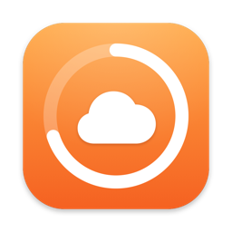
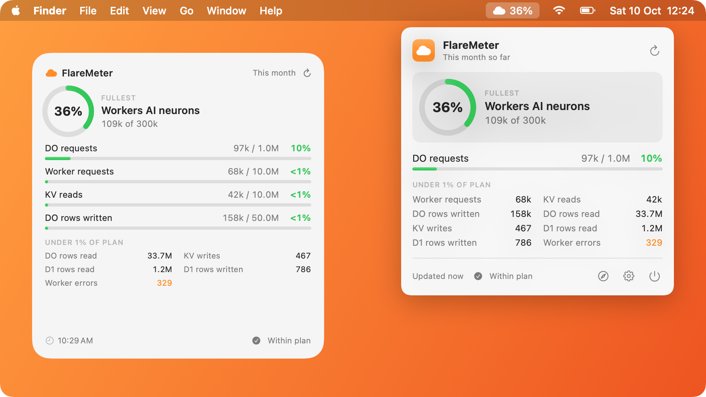
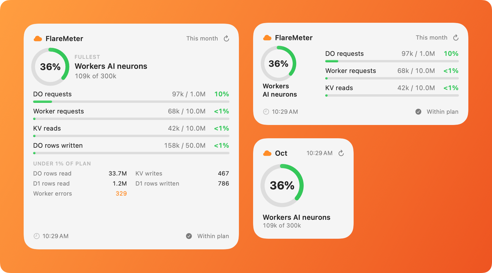
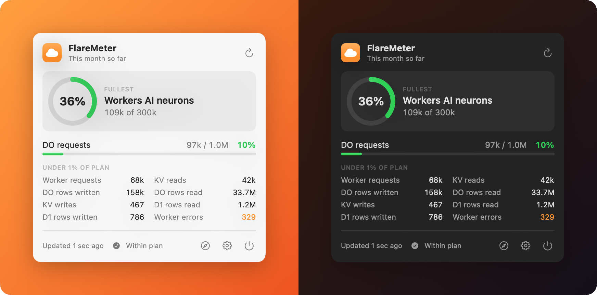
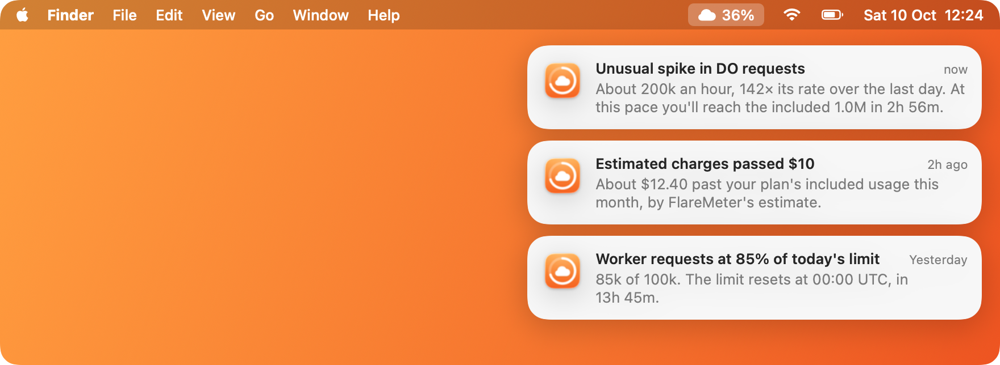

<div align="center">



# FlareMeter

**Know your Cloudflare limits before you hit them.**<br>
A free, open-source macOS menu bar app, desktop widgets and early-warning alerts for Workers, Durable Objects, KV, D1
and Workers AI.

[](LICENSE)
[](#build-from-source)
[](#how-it-works)
[](https://flaremeter.app/FlareMeter.dmg)
[](https://github.com/sponsors/manish-raana)
[](https://buymeacoffee.com/manishrana)

[Website](https://flaremeter.app) ·
[Download](https://flaremeter.app/FlareMeter.dmg) ·
[Alerts](#early-warning-alerts) ·
[Build from source](#build-from-source) ·
[Sponsor](#sponsor) ·
[Contributing](#contributing)

</div>

<br>

<picture>
  <source media="(prefers-color-scheme: dark)" srcset="docs/images/readme-hero-dark.png">
  
</picture>

<br>

FlareMeter shows how much of your Cloudflare plan you've used, without opening the dashboard. On **Workers Free** you
see how close you are to each daily cap and how long until it resets. On **Workers Paid** you see month-to-date usage
against the included amounts and an estimate of this month's overage charges. And when a limit gets close, a bill
starts to grow, or usage suddenly runs away, it tells you with a notification.

> [!NOTE]
> **Free and open source.** No price, no license key, no account. The signed and notarized download is free, and so is
> the code, under the AGPL-3.0. If FlareMeter saves you a surprise bill, consider [sponsoring it](#sponsor).

## Features

- **Early-warning alerts.** Notifications when a metric nears or reaches its limit, when estimated charges pass your
  budget, and when usage suddenly spikes. [More below](#early-warning-alerts).
- **Menu bar.** A cloud icon shows the percentage of your fullest metric, and turns into a warning cloud past 85%.
  Click it to see every metric, the time until the daily reset (Free) or estimated charges (Paid), and buttons for
  refresh, the Cloudflare dashboard and settings. There's no Dock icon.
- **Desktop widgets.** Small, medium and large sizes, each with its own refresh button.
- **One shared reading.** The menu bar and the widgets always show the same numbers. Whichever one fetches first saves
  the result and tells the other.
- **Automatic refresh.** Every 15 minutes, and again when your Mac wakes from sleep.
- **Simple setup.** Paste one read-only API token, then pick the account, Worker (or all Workers) and plan. Changes
  save immediately.
- **Several accounts.** Add another account's token in Settings, then switch between accounts from the menu bar panel.
  Each account keeps its own Worker and plan.
- **Quiet by default.** Metrics your account doesn't use, or that Cloudflare doesn't return, are hidden.
- **Light and dark.** Follows your Mac's appearance.

<picture>
  <source media="(prefers-color-scheme: dark)" srcset="docs/images/readme-widgets-dark.png">
  
</picture>

<p align="center"><sub>Large, medium and small widgets. Right-click the desktop, choose <b>Edit Widgets</b>, and search for FlareMeter.</sub></p>



## Early-warning alerts

<picture>
  <source media="(prefers-color-scheme: dark)" srcset="docs/images/readme-alerts-dark.png">
  
</picture>

FlareMeter checks every new reading and sends a macOS notification when:

- **A metric nears its limit.** At your warning level (80% by default), and again when it reaches the limit. You get
  each one once per day on Workers Free, and once per month on Workers Paid.
- **Estimated charges pass your budget.** On Workers Paid, once they're past the amount you choose ($10 by default).
- **Usage suddenly spikes.** A metric running at 10× or more its rate over the last day, for two readings in a row
  (about 30 minutes). That's what a runaway Durable Object alarm loop looks like. To stay quiet about small blips, the
  spike also has to be fast enough to use a whole day's (Free) or month's (Paid) allowance within that period. The
  notification tells you how soon you'd hit the limit at that pace, or what it costs per hour.

Click a notification to open the Cloudflare dashboard. Change what you're warned about in **Settings → Alerts**, which
also has a **Send Test Notification** button.

> [!TIP]
> Cloudflare processes billable usage once a day, so its own budget alerts arrive the day after a threshold is
> crossed. FlareMeter warns you within about 15 to 30 minutes, but only while your Mac is on and FlareMeter is running.
> Keep Cloudflare's alerts on too, and turn on **Launch at login**.

## Get FlareMeter

- **Download** the app from [flaremeter.app](https://flaremeter.app/FlareMeter.dmg). It's free, signed and notarized
  by Apple, and updates itself through [Sparkle](https://sparkle-project.org). It needs macOS 14 or later.
- **Build it yourself** from this repository, as described next.

## What it measures

All values come from Cloudflare's [GraphQL Analytics API](https://developers.cloudflare.com/analytics/graphql-api/).
"Today" is the current UTC day, and "month" is the current UTC month to date.

| Metric             | Workers Free (daily) | Workers Paid (included / month) | Paid overage price  |
| ------------------ | -------------------- | ------------------------------- | ------------------- |
| Worker requests    | 100,000              | 10 million                      | $0.30 / million     |
| Worker CPU time    | 10 ms per request²   | 30 million ms                   | $0.02 / million ms  |
| Worker errors      | shown, no limit      | shown, no limit                 | n/a                 |
| DO requests        | 100,000              | 1 million                       | $0.15 / million     |
| DO rows read       | 5 million            | 25 billion                      | $0.001 / million    |
| DO rows written    | 100,000              | 50 million                      | $1.00 / million     |
| DO storage         | 5 GB                 | 5 GB                            | not estimated       |
| KV reads           | 100,000              | 10 million                      | $0.50 / million     |
| KV writes¹         | 1,000                | 1 million                       | $5.00 / million     |
| D1 rows read       | 5 million            | 25 billion                      | $0.001 / million    |
| D1 rows written    | 100,000              | 50 million                      | $1.00 / million     |
| Workers AI neurons | 10,000               | 10,000 per day                  | $0.011 / thousand   |

¹ Writes, deletes and lists. ² A per-request cap, so on Workers Free CPU time is shown without a limit.

On Workers Paid the estimate also shows the bill with the $5 monthly subscription.

These are Cloudflare's published limits and prices as of **October 2026**. They live in
[Shared/Limits.json](Shared/Limits.json), which the app bundles and the website builds its tables from, together with
`asOf`, which Settings shows next to the plan.
Worker requests and errors can be narrowed down to a single Worker. Every other metric covers the whole account.

## Build from source

### Requirements

- macOS 14 Sonoma or later
- Xcode 15 or later, and [XcodeGen](https://github.com/yonaskolb/XcodeGen) (`brew install xcodegen`)
- An Apple ID signed in to Xcode. A free Personal Team is enough for your own copy.
- A Cloudflare API token with **Account → Account Analytics → Read**. No other permissions are needed.

### Steps

1. Clone the repository and sign in to Xcode with your Apple ID (**Xcode → Settings → Accounts**).

   ```sh
   git clone https://github.com/manish-raana/flare-meter.git
   cd flare-meter
   ```

2. Create `Local.xcconfig` next to [Config.xcconfig](Config.xcconfig) with your own team ID. It's git-ignored and
   overrides `Config.xcconfig`. Use `CFU_KEYCHAIN = NO` for a Personal Team (see
   [where the token is kept](#where-the-token-is-kept-cfu_keychain)).

   ```sh
   printf 'CFU_TEAM_ID = YOURTEAMID\nCFU_KEYCHAIN = NO\n' > Local.xcconfig
   ```

3. Build and install a Release copy to `/Applications`, so it runs without Xcode:

   ```sh
   ./scripts/install.sh
   ```

   To work on the code instead, generate the project and run the **FlareMeter** scheme:

   ```sh
   xcodegen generate
   open FlareMeter.xcodeproj
   ```

4. Click the cloud in the menu bar, then **Connect…** → **Create Token…**. This opens Cloudflare's token page with
   *Account Analytics · Read* already selected. Paste the token you create into FlareMeter. A user token (`cfut_…`)
   can't list its accounts, so in that case the app asks for your Account ID.

5. To add the widgets, right-click the desktop, choose **Edit Widgets**, and search for FlareMeter.

> [!IMPORTANT]
> `FlareMeter.xcodeproj` is generated from [project.yml](project.yml). Edit `project.yml` and run `xcodegen generate`
> again. Don't edit the project in Xcode.

## Configuration

All build-time settings are in [Config.xcconfig](Config.xcconfig) and reach the app and widget through `Info.plist`.
Put your own values in a git-ignored `Local.xcconfig`, which overrides it.

| Setting                  | Purpose                                                                                         |
| ------------------------ | ----------------------------------------------------------------------------------------------- |
| `CFU_TEAM_ID`            | Your Apple team ID. It also names the App Group (`<TEAM_ID>.flaremeter`) shared by app and widget. |
| `CFU_KEYCHAIN`           | `YES` keeps the token in the Keychain, `NO` keeps it in the App Group container (see below).      |
| `CFU_APPCAST_URL`        | The Sparkle update feed.                                                                        |
| `CFU_SPARKLE_PUBLIC_KEY` | The public EdDSA key that update signatures are checked against.                                |

### Where the token is kept (`CFU_KEYCHAIN`)

- **`YES`**: the token goes in the data protection Keychain, in an access group shared only by the app and the widget.
  This needs a provisioning profile, which a paid Apple Developer Program team keeps valid. Use this for release
  builds.
- **`NO`**: the token goes in the App Group container, which only the app and the widget can read. Use this for free
  Personal Team builds. With a free team, the provisioning profile for the Keychain entitlement expires after 7 days,
  and after that the app stops launching.

`App/FlareMeter*.entitlements` and `Widget/FlareMeterWidget*.entitlements` hold the two variants, and
`Config.xcconfig` picks the right one.

## How it works

```
                    ┌────────────────────────────┐
                    │  Cloudflare GraphQL API    │
                    └─────────────▲──────────────┘
                                  │ one query per metric, today + month
                       ┌──────────┴──────────┐
                       │  CloudflareClient   │  Shared/CloudflareClient.swift
                       └──────────▲──────────┘
                                  │
                       ┌──────────┴──────────┐
                       │   UsageRefresher    │  Shared/UsageRefresher.swift
                       └────▲───────────▲────┘
                            │           │
             ┌──────────────┴──┐     ┌──┴──────────────┐
             │  Menu bar app   │◀───▶│     Widgets     │
             │  (App/)         │     │  (Widget/)      │
             └─────────────────┘     └─────────────────┘
                     ▲      App Group: settings, last reading       ▲
                     └────────── Darwin notification on save ────────┘
```

- **Fetching.** Each metric is its own pair of GraphQL requests (today and month to date), and all of them run in
  parallel. If a dataset doesn't exist for the account, or a field name is wrong, only that metric is hidden. If
  *every* metric fails, the app shows the error instead, which usually means the token's permission or account is
  wrong.
- **Sharing.** The settings and the latest reading are stored in the App Group's `UserDefaults`.
  After a fetch, the result is saved there and a Darwin notification is posted, so the other side picks up the new
  numbers without fetching again.
- **Overage.** On Workers Paid, the estimated charge is Σ max(0, month − included) × price, summed over every metric
  that has a price. Workers AI's allowance is daily, so its "included" counts the days of the month so far. The menu bar
  adds the $5 subscription to show the month's bill.
- **Accounts.** Each connected account has its own token. The shown account's settings are what the menu bar and the
  widget read; switching saves the Worker and plan you'd picked for the account you leave.
- **Alerts** ([App/UsageAlerts.swift](App/UsageAlerts.swift)). The menu bar app checks each new reading, including
  ones the widget fetched. Limit and budget warnings are remembered per day or month, so each is sent once. Spikes
  compare the latest reading's rate with the rate over the last day of readings, which the app keeps across restarts.
- **Updates** ([App/AppUpdater.swift](App/AppUpdater.swift)). Sparkle checks the appcast on the website. Builds
  without a feed URL and key turn Sparkle off.

## Project layout

```
App/                      Menu bar app: entry point, panel, settings, first-launch welcome window, usage
                          store, alerts, Sparkle updater, marketing screenshot renderer, entitlements
Widget/                   WidgetKit extension: timeline provider and entitlements
Shared/                   Code used by both targets
  CloudflareClient.swift  GraphQL queries, account and Worker lookup
  Metrics.swift           Metric definitions, overage estimate, formatting
  Limits.json             Cloudflare's limits and prices, shared with the website
  Settings.swift          Settings and the shared snapshot cache (App Group)
  TokenStore.swift        API token storage, one per account (Keychain or App Group)
  UsageRefresher.swift    One fetch, saved and broadcast to the other side
  UsageViews.swift        Views shared by the panel and widgets
  WidgetViews.swift       Small, medium and large widget layouts
  PrivacyInfo.xcprivacy   Privacy manifest
Tests/                    Unit tests (limits, overage, formatting, account switching)
scripts/
  install.sh              Builds and installs a personal Release copy
  release.sh              Developer ID build, notarization, DMG and Sparkle appcast
  github-release.sh       Optionally attaches a DMG to a GitHub release
  deploy-site.sh          Builds web/ and deploys it to Cloudflare (flaremeter.app)
  render-marketing.sh     Renders screenshots from the real views into marketing/ and docs/images/
  make_icon.swift         Draws the app icon
web/                      Marketing site (Next.js 16, static export)
marketing/                App Store screenshots (light and dark)
docs/images/              README images
docs/releasing.md         Signing, notarization, releases and the launch checklist
project.yml               XcodeGen project spec
Config.xcconfig           Build settings (team, token storage, updates)
```

## Website

[web/](web/) is the site at [flaremeter.app](https://flaremeter.app): the landing page, pricing, guides on Cloudflare
Workers limits and pricing, about, contact, terms and privacy. It's built with Next.js 16 (static export), Tailwind
CSS 4 and Motion, and served as static files by Cloudflare.

```sh
cd web
npm install
npm run dev          # http://localhost:3000
```

Product facts such as the price and links are in [web/src/lib/site.ts](web/src/lib/site.ts). The app's panel and
widgets are recreated as animated React components in `web/src/components/mock/AppMocks.tsx`.

## Contributing

Issues and pull requests are welcome. A few things help:

- **Pricing changes.** Cloudflare's limits and prices change. If a number in [Shared/Limits.json](Shared/Limits.json)
  is out of date, a pull request that links the pricing page is one of the most useful contributions you can make.
- **Tests.** Run the **FlareMeter** scheme's tests in Xcode (⌘U), and `npm test` in `web/`. The CI workflow runs both,
  started by hand from the Actions tab.
- **Larger changes.** Open an issue first, so we can agree on the approach before you put time in.
- **Project files.** Change [project.yml](project.yml), not the generated `FlareMeter.xcodeproj`.
- **Your team ID.** Put your own `CFU_TEAM_ID` in `Local.xcconfig`, which git ignores, not in `Config.xcconfig`.
- **Screenshots.** If you change how the panel or widgets look, run `scripts/render-marketing.sh` to regenerate the
  images in `marketing/` and `docs/images/` from the real views.

By contributing, you agree that your contribution is licensed under the [AGPL-3.0](LICENSE).

## Releasing

This section is for maintainers. The one-time setup (Developer ID certificate, notarization credentials, the Sparkle
key backup and GitHub Sponsors) is in [docs/releasing.md](docs/releasing.md). After that, each release goes like this:

1. Check the limits and prices in [Shared/Limits.json](Shared/Limits.json) against Cloudflare's pricing pages
   ([Workers](https://developers.cloudflare.com/workers/platform/pricing/), D1, KV, Durable Objects, Workers AI).
   Update `asOf` and `lastReviewed`.
2. Raise `MARKETING_VERSION` and `CURRENT_PROJECT_VERSION` in [project.yml](project.yml). Sparkle compares the build
   number.
3. Run `scripts/release.sh`. It archives the app, signs it with Developer ID, notarizes and staples the app and the
   DMG, and updates `web/public/appcast.xml`. With the GitHub CLI signed in, it also attaches the DMG to a GitHub
   release.
4. Commit `web/public/` and the version bump, then run `scripts/deploy-site.sh`. Existing users get the update through
   Sparkle, and new users download `FlareMeter.dmg`.

`release.sh` refuses to run unless `CFU_KEYCHAIN = YES` is set, and it won't re-release a build number that is already
in the appcast.

## Privacy

FlareMeter talks to only two places:

- Cloudflare's API, to read your analytics
- The FlareMeter website, to check for updates

Alerts are local macOS notifications, worked out on your Mac. FlareMeter collects no analytics or telemetry. Your API token stays on your Mac, in the Keychain or the app's private App
Group container, and it only needs read access to account analytics. The full policy is at
[flaremeter.app/privacy](https://flaremeter.app/privacy).

## Sponsor

FlareMeter is free, and it stays free. Sponsoring, or buying me a coffee, pays for the Apple Developer Program
membership that signs and notarizes the download, and for the time it takes to keep up with Cloudflare's limits and
prices.

<a href="https://github.com/sponsors/manish-raana"></a>
<a href="https://buymeacoffee.com/manishrana"></a>

## License

FlareMeter is free software: you can redistribute it and/or modify it under the terms of the
[GNU Affero General Public License v3.0](LICENSE), as published by the Free Software Foundation, either version 3 of
the License, or (at your option) any later version. It is distributed in the hope that it will be useful, but without
any warranty.

In short, you can use, study, change and share FlareMeter. If you distribute a modified version, or let others use one
over a network, you must make its source available under the same license.

Copyright © 2026 Manish Rana ([mkrana173@gmail.com](mailto:mkrana173@gmail.com), GitHub [@manish-raana](https://github.com/manish-raana), X [@ManishRaanaa](https://x.com/ManishRaanaa)).

<br>

<div align="center">
<sub>
Built by <a href="https://x.com/ManishRaanaa">Manish Rana</a> ·
<a href="https://flaremeter.app">flaremeter.app</a><br>
More from us: <a href="https://localinbox.app">LocalInbox</a>, the Mac email app with on-device AI ·
<a href="https://usedocs.app">usedocs</a>, docs that keep up with your code and your customers<br>
FlareMeter is an independent project, not affiliated with or endorsed by Cloudflare, Inc.
</sub>
</div>
